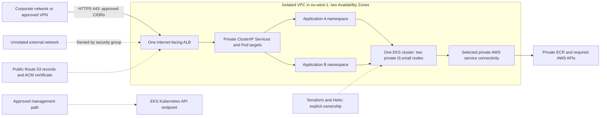

# DEVOPS-003 — Build a Reusable Private AWS Application Hosting Platform

## Project ID and title

**DEVOPS-003 · Build a Reusable Private AWS Application Hosting Platform** · Assignment **1.0.0**. Primary domain: AWS; related domains: Kubernetes, infrastructure as code, networking and security.

## Difficulty and expected duration

**Advanced · 24–36 hours of engineering work**, excluding approvals, DNS/certificate propagation and other waiting periods. Deployment model: **temporary lab — apply, verify, destroy** in **eu-west-1**. Target incremental AWS expenditure: **$20–30**, not a guaranteed maximum. Engineering effort is not a requirement to leave AWS running for that entire period.

## Problem statement and business context

Your team needs a reusable foundation for hosting multiple containerized applications in an existing shared AWS Sandbox. Build the shared networking, EKS, identity, registry and ingress capabilities once. New applications should supply their own image, namespace, configuration and routing without replacing the VPC, cluster, workers or load balancer.

You have an existing IAM Identity Center assignment providing `AdministratorAccess`. That is an organizational constraint, not permission to attach administrator policies to the platform. A mistake made through that human session can affect other users. Never modify, destroy, import into state or take ownership of unrelated infrastructure. Inspect the account, agree ownership boundaries, and obtain reviewer approval before deployment.

This is an engineering assignment, not a complete implementation tutorial. Choose and justify your module boundaries, management access, endpoint topology, application packaging and ownership model. Use [verification](verification.md) and [versions and costs](versions-and-costs.md) as the evidence and source contracts.

## Learning objectives

- Design reusable application onboarding with shared infrastructure and independent workload configuration.
- Provision private AWS compute and verify the actual dependencies of a no-NAT environment.
- Separate human, Terraform, control-plane, node, controller and application identities and prove least privilege.
- Demonstrate corporate-only HTTPS access with independently controlled DNS and trusted certificates.
- Measure cost, safely dismantle controller-owned and Terraform-owned infrastructure, and verify the final inventory.

## Prerequisites

Know Terraform modules, remote state and dependency ordering; Kubernetes, Helm, containers, IAM, VPC routing, DNS and TLS. Earlier projects are useful experience but are not formal prerequisites. Have AWS CLI v2 with the approved SSO profile, Terraform, kubectl, Helm, Docker, jq, dig, curl and OpenSSL, plus the pinned [version contract](versions-and-costs.md#version-contract).

Obtain reviewer-approved Sandbox/account identity, ownership prefix and tags, approved S3 backend/key and locking permissions, corporate public egress CIDRs supplied through protected inputs, and a public domain you control. You must be able to manage its registrar nameservers and authoritative DNS independently, without corporate DNS administrators. An existing controlled domain is preferred; new registration requires approval of its separate annual charge. Complete read-only account discovery and check quotas, instance availability and the standard-support Kubernetes version in eu-west-1 before planning.

Arrange an approved corporate network/VPN and a genuinely unrelated external network for positive/negative access tests. Obtain a documented Kubernetes API management path that does not expose worker nodes. Do not start a billable deployment while these prerequisites remain blocked.

## Target architecture



Show your actual subnet/AZ placement, routes, security groups, endpoint identities, state boundary and request path in your own diagram. This diagram states boundaries, not a ready-made resource layout. Two small nodes across two AZs do not guarantee application high availability or arbitrary workload capacity.

## Mandatory technology stack

AWS, Terraform, Amazon VPC, Amazon EKS, Amazon ECR, IAM, Kubernetes, Helm, AWS Load Balancer Controller, Route 53 and ACM. Use [source-checked pins](versions-and-costs.md), provider/chart locks and immutable image identities; confirm support and compatibility before applying. No floating `latest` tags or unbounded provider/chart versions. The author inspected documentation and a versioned controller chart on **2026-10-27**; no AWS deployment or runtime compatibility test was performed.

## Functional requirements

Deploy **two lightweight web applications in different namespaces**. Each must have its own image/build identifier, Deployment, ClusterIP Service, Ingress route, service account, ConfigMap/configuration, secret references, environment variables, probes, resource requests/limits and rolling-update configuration. Each offers a browser-visible interface, a health endpoint and a visible version/build identifier. JSON output alone is not a browser UI.

At least one private ECR repository must be provisioned with Terraform. Build and push the application images yourself and prove that private nodes pull them. [DEVOPS-002](../../build-and-release-engineering/java-inventory/index.md) is an optional application source, not a prerequisite; reuse only if your demonstration also satisfies the UI, health and capacity requirements. A smaller alternative is acceptable. Do not make the platform depend on a database-specific application.

Use a reusable Helm chart or well-structured parameterized manifests. Onboard application B after A works, using different configuration and a distinct hostname such as `app.example-training-domain.tld` and `demo.example-training-domain.tld`. `api.example-training-domain.tld` is another illustrative hostname; all are placeholders, not domains to register. Updating or deleting A must not disrupt B. The second onboarding must reuse the same VPC, EKS cluster, worker nodes and ALB.

## Infrastructure requirements

### Terraform and ownership

Separate networking, EKS, IAM, ECR, Kubernetes platform components, ingress/load balancing, DNS/certificates and application onboarding into logical modules or similarly maintainable components. No prescribed directory tree is required if boundaries and dependencies are clear. Use version constraints, variables/outputs, environment-specific inputs, consistent names and ownership tags.

Use the **approved S3 remote backend**, distinct state keys and working state locking; document encryption, access, versioning and recovery. Do not import the shared backend or unrelated account resources into the lab state. Sensitive values can still reside in state, plans and Helm release records. Keep them private and out of Git. Design reproducible staged deployment/destruction where Kubernetes/Helm providers need a live reachable cluster; avoid relying on undocumented repeated applies.

Maintain an ownership inventory: Terraform resources, Helm releases, controller-reconciled resources, existing read-only dependencies and any explicitly retained assets. The controller may own ALB listeners, rules, target groups and related resources; Terraform must not independently manage those same objects. Terraform can own the release, IAM, inputs and related DNS/certificate resources. Explain the actual boundaries you implement.

### VPC and private connectivity

Provision one isolated, modest, nonoverlapping VPC in eu-west-1 with **two AZs, two public ALB subnets and two private worker/workload subnets**, appropriate route tables, associations and security groups. Worker nodes must have no public IPv4 addresses or publicly reachable IPv6 addresses; avoid accidental IPv6 ingress/egress bypasses. No public database and **no NAT Gateways or substitute NAT instances**. Only the shared ALB is an internet-facing **application** endpoint; no public NodePorts, separate load-balancer Services or public workload management ports.

Document and implement the private paths your selected nodes, add-ons, identities and controllers need. Evaluate ECR API, ECR registry and S3 image-layer access, EC2, Elastic Load Balancing, STS where needed, EKS management/EKS Auth where needed, logging and any other dependencies you introduce. This is an investigation list, **not a universally sufficient endpoint recipe**. Record callers, DNS, ports, routing, endpoint security/policies, AZ placement, image sources and cost for every required path. Account for platform/controller images as well as application images; mirror images into private ECR when their source is unreachable, including first-pull/bootstrap behavior.

Distinguish the **Kubernetes API server endpoint** from the AWS **EKS management API** and any identity-specific EKS Auth endpoint. An EKS interface endpoint does not by itself provide Kubernetes API access. Enable cluster private endpoint access for private nodes. Prefer private-only API access with a reviewer-approved management network path; if choosing public plus private API access, restrict the public management CIDRs and justify it separately from the application ALB. Never expose worker nodes to solve administration. Include extra management connectivity in the budget.

### EKS and capacity

Provision **exactly one EKS cluster, one managed node group and exactly two `t3.small` workers**, all in private subnets. Use a Kubernetes minor within EKS standard support, compatible CoreDNS, kube-proxy and VPC CNI, and explicit cluster/node security groups, IAM roles and access management. Set and document node-group minimum, desired and maximum sizes consistent with two workers; do not install autoscaling that silently changes this baseline. Show both nodes Ready.

Document Pod networking/IP capacity, allocatable resources, daemon overhead, requests/limits, rollout headroom, image architecture, log selection and retention. Two `t3.small` nodes are restrictive; choose small images/workloads and fit the controller, system add-ons and both demonstrations. Do not solve capacity problems by quietly adding larger or extra nodes. Obtain review of an alternative only as an explicit assignment deviation.

### Shared ingress and corporate-only access

Install AWS Load Balancer Controller through Helm with a dedicated least-privilege Pod Identity or IRSA role. Use **one shared internet-facing Application Load Balancer**, HTTPS **443**, ACM TLS, independent application listener rules, target groups and health checks, and IP targets where appropriate for direct Pod routing. Verify readiness and backend connectivity rather than assuming an Ingress object proves success. The second application must not create another ALB.

ALB ingress must permit **TCP 443 only from approved corporate public egress CIDRs**, provided as approved input variables. Never guess addresses or allow application ingress from `0.0.0.0/0` or `::/0`. Keep port 80 closed; a redirect is not required. Restrict backend security groups to the intended ALB-to-target path. Check the effective combined behavior of shared ingress configuration and attached security groups after each onboarding. Shared routing is a trust boundary; restrict who can create or modify routes affecting other applications.

### DNS and TLS ownership

Use a reviewer-approved public domain under your independent control, a Route 53 public hosted zone, correct registrar authoritative NS configuration, ACM public certificate in the ALB's region, DNS validation and Alias records to the ALB. Prove authoritative and public resolution and normal browser certificate trust. Creating a hosted zone **does not register a domain**. Do not request changes to corporate zones. Public DNS is compatible with restricted network access.

Separate persistent registration/approved hosted-zone ownership from ephemeral compute. Do not recreate registration on every lab run. For an existing domain/zone, obtain explicit permission for the exact DNS changes and reference only approved owned assets; do not adopt unrelated records or disrupt existing services. Record whether registration, hosted zone, validation records and certificates are retained, by whom and at what ongoing cost. Remove stale application records/certificates according to the approved retention plan.

## Security requirements

Provide an IAM matrix containing **role name, trusted principal, purpose, attached permissions, resource scope, conditions, associated AWS/Kubernetes resource, and justification for permissions that cannot be resource-scoped**. Cover the EKS cluster, managed nodes, CNI/other add-ons, load-balancer controller, workload identities when needed, Terraform execution and any extra services such as CodeBuild. Explain trust relationships and `PassRole`/role-assumption boundaries.

Never grant `AdministratorAccess` to nodes, Pods, controllers, build projects or other provisioned components. Separate the existing administrator session from a dedicated least-privilege Terraform execution role where organizationally possible; document any approved provisioning exception without hiding its residual administrator risk. Use Pod Identity or IRSA as supported by your SDKs/networking. Applications with no AWS API need should receive **no AWS role**. Verify they cannot fall back to a privileged node identity or inherit administrator access; consider IMDS restrictions, service-account credentials, RBAC and secret-read permissions.

Namespaces are organization boundaries, not strong tenant security by themselves. Implement appropriate RBAC and network isolation; use and test NetworkPolicies when supported/enabled by the chosen networking implementation, document enforcement and required DNS/probe/ingress paths. Protect shared ingress configuration. Use non-root containers where practical, minimal images and no unnecessary privileges. Store secret values outside source; use references/bootstrap or an approved secret service, and never publish tokens, real CIDRs, sensitive account IDs, passwords, kubeconfigs or state/plan files.

Least privilege inside the platform does **not** remove risks of your pre-existing administrator session. Tags/names aid attribution; permissions boundaries and AWS Budgets are not a hard account-wide isolation or spending limit against an unrestricted administrator. Respect all existing account owners.

## Milestones and deliverables

1. **Discovery and design:** read-only account inventory, ownership and trust matrix, diagrams, supported-version/private-path inventory, independent-domain permission and a costed short deployment window. Obtain design/cost approval before cloud changes or domain purchase.
2. **Plan review:** prepare modules, state/backend strategy, pins/locks, environment inputs and staged runbook. Run formatting/validation and Terraform plans; obtain reviewer approval of the actual plan(s) and submission SHA **before each apply**. Replan and renew approval when scope changes.
3. **Foundation:** provision through approved plans; demonstrate private networking, two Ready workers, correct add-ons, identities, image paths and remote-state locking.
4. **First application:** build/push image, deploy parameterized configuration, provision shared ingress, DNS validation and HTTPS. Capture corporate-network browser/health success and external-network denial.
5. **Reusable onboarding:** introduce application B independently, prove shared infrastructure identity/count stability, then update and remove A while B remains usable. Preserve the timestamps and results.
6. **Destruction and cost closure:** capture evidence, remove workload/controller-managed cloud objects while the controller and cluster still exist, destroy ephemeral Terraform resources, verify the post-run inventory and reconcile actual charges when billing catches up. Record approved retained assets and pending billing follow-up explicitly.

## Acceptance criteria

| Gate | Mandatory outcome and evidence |
| --- | --- |
| Ownership | Approved design and actual plans; correct Sandbox/region, unique tags, protected remote state, no unrelated adoption or modification |
| Network | Two public/two private subnets across two AZs; correct routes/endpoint paths; no NAT, public workers or public database |
| Cluster | One EKS cluster in standard support, one managed group, exactly two Ready `t3.small` private workers with compatible core add-ons |
| IAM | Complete trust/permissions matrix, dedicated constrained identities, justified unscopable actions, no provisioned administrators or app privilege inheritance |
| Images/workloads | Terraform private ECR, successful private image pulls, two namespaces and independent images/configuration/service accounts/probes/resources/rolling updates |
| Ingress | Exactly one shared internet-facing ALB with corporate-only 443, healthy target groups and correct separate application rules; no port-80 requirement or bypass entrypoint |
| DNS/TLS | Independently managed approved domain, authoritative NS, Route 53 Alias records, issued ACM certificate and successful normal HTTPS/browser validation |
| Access tests | Corporate/VPN success and unrelated-network transport denial, with matched DNS/hostnames and no TLS-verification bypass |
| Reuse | Second onboarding leaves VPC/cluster/node-group/worker and ALB identities intact; updating/deleting A preserves B functionality |
| Cost/lifecycle | Approved estimate targeting $20–30, short runtime, verified destruction/orphan inventory, explicit retained costs and actual billing reconciliation or dated pending follow-up |
| Handover | Reproducible staged deployment/destruction, locks, diagrams, sanitized CLI/browser evidence, expected/actual results and disclosed unexecuted checks |

Every mandatory gate needs evidence. No optional extension compensates for a failed security, reuse or cleanup gate. A successful CLI exit alone is not proof of the desired state; empty output must be interpreted against the expected resource count.

## Verification procedures

Follow [verification and teardown](verification.md) and its prerequisite/target guards. Record immutable submission SHA, timestamps, expected versus actual results, exit statuses, region and local resource identities. Share sanitized excerpts and browser screenshots; keep full plans, corporate CIDRs, credentials and sensitive account identifiers private for reviewer inspection. Never describe a configuration review as a passed runtime test.

## Expected submission structure

Use a separate learner repository following [standards](../../../standards.md), with an equivalent justified layout:

```text
README.md                    # DEVOPS-003 1.0.0, setup, stages, access and teardown
terraform/                   # logical modules/components, non-secret examples and provider lock
helm/                        # platform release inputs and reusable application packaging
applications/                # two small applications and independent image/config identities
scripts/                     # explicit-target preflight, checks and safe cleanup interface
diagrams/                    # traffic, private service paths, IAM/state/ownership boundaries
validation/                  # acceptance matrix, sanitized outputs, browser and negative tests
costs.md                     # dated eu-west-1 rates, runtime estimate, retained costs and actuals
versions.md                  # exact versions, image digests, charts/add-ons and support evidence
.gitignore                   # excludes state, plans, keys, credentials and real environment inputs
```

Include reviewer approval references without sensitive contents, the IAM and resource ownership matrices, domain lifecycle decision, deployment deadline, all tests/failures/retests and a final inventory. Submit repository URL, immutable SHA and assignment version. Do not put a learner implementation in this portal.

## Constraints and non-goals

No continuously running environment within this budget; no NAT Gateways, NAT instances, mandatory RDS, Aurora, WAF, public database, extra cluster or extra ALB. No domain purchase without separate approval. Do not import or destroy other people's resources or treat an administrator session as a safely constrained test identity. Do not claim full HA, hard budget enforcement or complete tenant isolation from the baseline topology.

The portal author performs documentation work only. Learner AWS execution happens later, under the specified reviewer approvals; none of the diagnostic examples authorize the authoring agent to change AWS or Kubernetes.

## Optional stretch goals

Only after baseline gates and separate cost/plan approval: a standard **Amazon RDS** extension, not Aurora or Multi-AZ. Use `db.t3.micro` or `db.t3.small` only where the engine/region supports it, minimal practical storage, private networking, restrictive SGs and secure credentials (prefer Secrets Manager, costed separately). Prove private application connectivity and verified DB/snapshot/secret teardown. Estimate additional storage, backup, secret and runtime charges; the platform must work without it. Other optional improvements include extra observability or automated static checks within the same reviewed cost envelope.

## Reviewer guidance

Expect design and plan reviews before deployment, live positive/negative HTTPS verification, IAM explanations, the second-application independence test and a demonstrated cleanup inventory. A reviewer must be able to distinguish evidence from assumptions. Detailed evaluation material stays outside the published learner site; original projects and protected follow-ups retain their existing review process.
