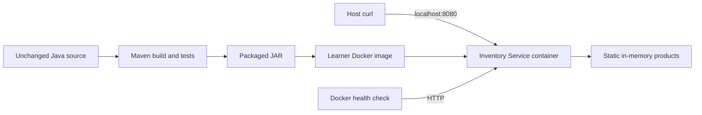

# DEVOPS-002 — Repair, Build and Containerize a Java Application

## Project ID and title

**DEVOPS-002 · Repair, Build and Containerize a Java Application** · Assignment version **1.0.0**.

## Difficulty and expected duration

**Beginner · 4–6 hours**, excluding optional enhancements. Primary domain: Build and Release Engineering; secondary domain: Containers.

## Problem statement and business context

Your team inherited a small Inventory Service before a release. The Java implementation is complete, but the delivery path is unreliable. Take ownership of the build, investigate each failure, and produce a repeatable local container deployment with evidence that it works.

Start from the [public starter repository](https://github.com/Merqreal/devops-002-java-starter). The initial build is intentionally unsuccessful. Diagnose what you observe instead of replacing the project. **Java source modifications are prohibited**, including test changes, deletion, generated replacements, or bypassing existing functionality. Preserve all files under `src/` byte for byte. Corrections belong in Maven configuration and learner-authored deployment files.

## Learning objectives

- Diagnose Maven failures from the first meaningful error and explain the underlying cause.
- Build and test a Java service from source using JDK 17.
- Create a Docker image and Compose service that execute the packaged JAR.
- Investigate container logs, rebuild after corrections, and verify HTTP behavior and container health.
- Produce a troubleshooting report another engineer can reproduce.

## Prerequisites

Know basic Git, shell commands, containers, HTTP, and JSON. Have Git, JDK 17, Docker Engine with Compose v2, and curl available. No earlier assignment is required. Allow approximately 4 GB RAM, 3 GB free disk, internet access to Maven Central and your chosen image registry, and an unused localhost port 8080. No cloud account or paid services are required.

Clone or fork the starter into your own submission repository. Record its original commit SHA before making changes. Verify `java -version`, `docker version`, and `docker compose version`; use `./mvnw --version` to confirm Maven runs on JDK 17. On Windows, use WSL2 or the supplied `mvnw.cmd` for Maven.

## Target architecture



Docker Compose owns one service. Product data belongs to the application and requires no persistent volume. Maven may run on the host or in a build stage, but the deployed artifact must be built from this source.

## Mandatory technology stack

Use **Java 17**, the supplied **Maven 3.9.16 Wrapper (3.3.4)**, **Spring Boot 4.0.8**, Docker, and Docker Compose v2. Keep the starter's parent and dependency management versions; do not change framework versions to work around failures. Dependencies and standard build plugins inherit fixed versions from the versioned Spring Boot parent; record any added plugin versions explicitly.

Choose a maintained Java 17 image, pin its exact tag and immutable digest, and record your Docker Engine/Compose versions and image digest. Do not use `latest`. The deployment contract requires port 8080, JSON over HTTP, a `java -jar` startup command, and a health check against `/actuator/health`. Install or otherwise provide any tool your health command needs.

Upstream contracts checked **2026-10-20**: [Spring Boot 4.0 system requirements](https://docs.spring.io/spring-boot/4.0/system-requirements.html), [versioned parent POM](https://repo.maven.apache.org/maven2/org/springframework/boot/spring-boot-starter-parent/4.0.8/spring-boot-starter-parent-4.0.8.pom), [Maven Wrapper](https://maven.apache.org/tools/wrapper/), [Dockerfile reference](https://docs.docker.com/reference/dockerfile/), and [Compose health check contract](https://docs.docker.com/reference/compose-file/services/#healthcheck). These sources describe configuration; they do not replace runtime evidence from your submission.

## Functional requirements

The following responses must be available at `http://localhost:8080`:

| Request | Required result |
| --- | --- |
| `GET /` | HTTP 200 JSON with `service: Inventory Service` and `version: 1.0.0` |
| `GET /api/products` | HTTP 200 JSON array with IDs 1–3: Keyboard (12), Mouse (25), Monitor (7) |
| `GET /api/products/1` | HTTP 200 JSON with `id: 1`, `name: Keyboard`, `quantity: 12` |
| `GET /api/products/999` | HTTP 404 |
| `GET /api/products/nope` | HTTP 400 |
| `GET /actuator/health` | HTTP 200 JSON with `status: UP` |

Verify all three valid product IDs match their entries in the collection. Product state is static; no write endpoints are required.

## Infrastructure requirements

Author a Dockerfile, `.dockerignore`, and `compose.yaml`. Build the JAR from source with Maven and package it into a local image. Compose must build your image, run the packaged JAR with `java -jar`, and bind `127.0.0.1:8080` to container port 8080. Do not mount host build output into the final running container.

Capture logs and the exit status when the packaged application first fails in a container. Diagnose and correct the underlying build configuration, rebuild the JAR and image, then repeat verification. A successful Maven package is a milestone, not proof that the container works. Configure a bounded Docker health check and show the container reaches `healthy`. Demonstrate teardown and a fresh rebuild/start using documented commands.

## Security requirements

Run the final application as a non-root user. Expose it only on localhost; do not publish management endpoints beyond health. No credentials are required. Exclude Git data, caches, unrelated files, and sensitive local configuration from the Docker context. Never commit secrets, generated JARs, Maven caches, or raw environment dumps. Sanitize troubleshooting evidence before committing it.

## Milestones and deliverables

1. **Baseline and investigation:** record the starter SHA, tool versions, initial build command, exit status and meaningful error excerpt. Deliver the first troubleshooting entry.
2. **Build and tests:** investigate subsequent failures, make configuration corrections, and produce a successful clean Maven package with all tests passing. Deliver a focused configuration diff and test summary.
3. **Container diagnosis:** author the deployment files, run the packaged JAR in Docker, and capture failing container logs before correcting the build configuration. Deliver failure evidence tied to a commit or diff.
4. **Recovery and operation:** rebuild, start through Compose, verify every endpoint and container health, then tear down and repeat. Deliver final commands, HTTP results, health evidence and cleanup instructions.
5. **Handover:** complete your README, architecture diagram and troubleshooting report. Include symptoms, investigation commands, competing hypotheses, root causes, corrections, and verification for every observed failure.

## Acceptance criteria

- `src/` matches the original starter exactly; no source or test modifications are accepted.
- A clean checkout builds from source with JDK 17 using `./mvnw clean package`; all supplied tests execute and pass without skip flags.
- Your Dockerfile builds a runnable local image, and Compose starts it using `java -jar` on localhost:8080.
- Evidence includes initial Maven failure, investigation of subsequent failures, successful packaging, failing container logs and successful recovery.
- All endpoint checks in the functional table pass; valid product IDs agree with the collection.
- Docker reports `healthy`, and the health command exists in the image and checks the HTTP endpoint.
- The application runs as non-root, only localhost is published, and no extra management information or secrets are exposed.
- A second clean build/start succeeds using only the submitted instructions, followed by successful teardown.
- The report connects each correction to observed evidence and explains why tests, packaging, startup and health are separate verification gates.

## Verification procedures

Start with the original checkout and capture build output and its exit status. Use the first meaningful error to choose your next inspection command. Keep each correction small and rerun the same clean build. Do not skip tests or change JDK versions to make an error disappear.

After packaging, use your own Dockerfile and Compose file. Useful observation commands include:

```sh
./mvnw clean package
docker compose build --no-cache
docker compose up -d
docker compose ps -a
docker compose logs --no-color
curl -i http://localhost:8080/
curl -i http://localhost:8080/api/products
curl -i http://localhost:8080/api/products/1
curl -i http://localhost:8080/api/products/999
curl -i http://localhost:8080/api/products/nope
curl -i http://localhost:8080/actuator/health
docker compose down --remove-orphans
```

These commands depend on your authored deployment configuration and are not a complete solution. Also check products 2 and 3, inspect Docker health history and the container user, and compare `src/` against the recorded starter SHA. Record timestamps, exit codes, test counts and image identity. Preserve a concise failing-container log before rebuilding. If a command was not run, label it unverified; do not infer runtime success from a configuration review.

Troubleshooting is mandatory: distinguish build, dependency, artifact, startup, networking and health observations using evidence. Explain rejected hypotheses as well as the root cause. Submit readable excerpts rather than unfiltered Maven debug output.

## Expected submission structure

Submit a separate learner repository with this layout:

```text
pom.xml
mvnw
mvnw.cmd
.mvn/wrapper/maven-wrapper.properties
src/                         # unchanged application and tests
Dockerfile
.dockerignore
compose.yaml
README.md                    # prerequisites, build/run/check/cleanup
troubleshooting.md           # symptoms, investigation, causes, corrections
architecture.md              # diagram and runtime boundaries
evidence/                    # sanitized excerpts and HTTP/health results
```

Provide the repository URL, final commit SHA, original starter SHA, **DEVOPS-002**, assignment **1.0.0**, tool versions and image digest. Keep investigation commits or describe exact intermediate diffs so the failure/recovery sequence can be reviewed. Do not submit a prebuilt JAR.

## Constraints and non-goals

Do not modify any Java source, tests, or application resources under `src/`. Do not add a database, frontend build, external API, authentication, Kubernetes, cloud infrastructure, or CI pipeline as mandatory work. Do not replace Maven, disable tests, remove functionality, use `spring-boot:run` as the final container command, or copy a prebuilt artifact from elsewhere. No solution POM or Docker configuration is supplied.

## Optional stretch goals

After meeting every mandatory criterion, add image size analysis, resource limits, or a reproducible build comparison. Explain tradeoffs and keep the baseline workflow usable without these enhancements.

## Reviewer guidance

Submit evidence that a reviewer can reproduce from a clean checkout. Be ready to explain the build lifecycle, dependency resolution, executable artifacts, container logs and health transitions. Review includes source preservation, tests, live HTTP checks, container configuration, troubleshooting quality and cleanup. Author reference materials are kept separately and are not part of the starter or public assignment.
