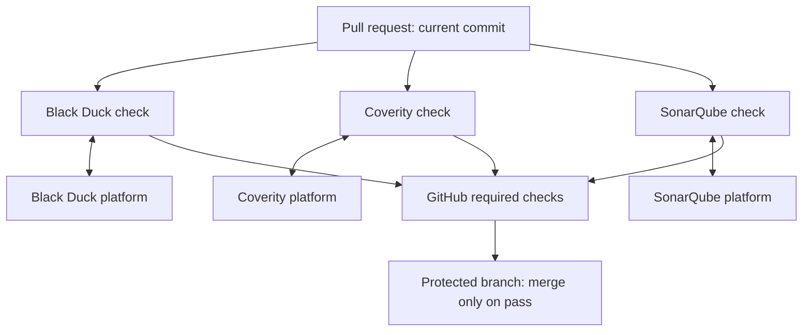

# DEVOPS-005 — Automated Pull Request Security Gates with GitHub Actions

## Project ID and title

**DEVOPS-005 · Assignment version 1.0.0**

## Difficulty and expected duration

Advanced · 24–40 hours, excluding optional work. Primary domain: DevSecOps; also CI/CD and security.

## Problem statement and business context

Teams need reusable checks that identify vulnerable dependencies, source weaknesses and quality problems before changes merge. Design and demonstrate three independent GitHub Actions integrations that could form a foundation for later adoption. Use only synthetic applications and authorized sandbox services; do not connect company repositories or platforms.

## Learning objectives

- Evaluate licensing, language coverage and practical limits before selecting scanner editions.
- Build reusable, independent checks and explain complementary scanner responsibilities.
- Prove fail-closed merge protection on current commits, including remediation and failure cases.
- Explain how untrusted pull request code, secrets and isolated runners are handled.

## Prerequisites

Know Git, GitHub Actions, branch protection, secure CI, Java and JavaScript builds. You need a GitHub account with suitable repository and ruleset features, eligible scanner accounts and access to their documentation. If using CodeBuild, use only an existing AWS Sandbox and Terraform. Check eligibility and costs **before** creating resources. See [versions, licensing and costs](versions-and-costs.md).

## Target architecture

The three paths run independently and may run concurrently. Each returns a final result for the current commit to a uniquely named required check; merge protection requires all three.

The diagram describes logical communication, not permission to expose secrets to pull request code. Explain the trust boundary and scanner-specific data flow in your own diagram.

## Mandatory technology stack

Use GitHub Actions, Black Duck SCA, Coverity and SonarQube in eligible free offerings. GitHub-hosted runners are acceptable; AWS CodeBuild in the Sandbox is optional. Record exact scanner, runtime, build tool and integration versions, pinned external actions and compatibility evidence using the selected editions' versioned upstream contracts. See [versions and costs](versions-and-costs.md) for sources and limitations. No scanner integration was executed by the assignment authors.

## Functional requirements

1. Create three reusable workflows or actions, triggered for pull requests opened, reopened and updated. They expose stable, unique and independent checks, for example `security / blackduck`, `security / coverity` and `security / sonarqube`. Support parallel execution and minimal consumer configuration.
2. Support Maven, Gradle, npm JavaScript and TypeScript projects. Make build commands, scanner settings and project identifiers, runner selection, severity thresholds and timeouts configurable. Provide clear, sanitized summaries. Pin scanner versions and external actions appropriately.
3. Assign Black Duck primary responsibility for third-party components and dependency vulnerabilities, Coverity for source-code security, and SonarQube for quality, reliability, maintainability and complementary security. Investigate rules and document enabled categories, overlap, exclusions and their rationale. Do not remove security coverage merely to reduce duplicate findings.
4. Create four independent test repositories: Java/Maven, Java/Gradle, JavaScript/npm and TypeScript application or IaC. Each has a reproducible clean baseline, real manifests, lockfiles and appropriate wrappers. Choose the application designs yourself.
5. Configure branch protection or rulesets to require all checks where the GitHub plan supports it. Map vendor severities and SonarQube quality gate conditions to check conclusions, including any additional blocking thresholds. Critical security findings block merging. Obtain the final analysis result, not merely an accepted submission; associate it with the current commit. Errors, authentication failure, unavailable platform, missing or stale results, timeout and unexpected skips must not yield a successful required gate. Investigate GitHub's skipped-job behavior and demonstrate your design handles it.
6. Use isolated test pull requests with documented known vulnerabilities and controlled source or quality weaknesses. Each repository needs a confirmed critical vulnerability case; across all four, exercise all three scanners meaningfully. Do not assume runtime or build-tool vulnerability detection. Distinguish CVE severity from vendor quality or weakness classifications.
7. Record for every case the component or weakness, affected version if relevant, CVE/CWE if applicable, severity and authoritative source, expected scanner, actual finding, expected and actual check outcome, and remediation.

## Infrastructure requirements

Use isolated ephemeral jobs with sufficient tooling and independent parallel capacity. If using CodeBuild-hosted runners, submit reproducible Terraform for the Sandbox, covering runner isolation, least-privilege IAM, short-lived credentials where applicable, network access to scanner endpoints, job timeouts, resource limits, cost estimates and cleanup. Avoid persistent resources and shared sensitive files. Free scanner access does not make AWS usage free.

## Security requirements

Treat pull request code, dependencies and build commands as untrusted, including internal changes. Do not run untrusted code with scanner tokens or privileged AWS credentials; explain and demonstrate how your design enforces this boundary, including build-time exfiltration and modified workflows. Do not use `pull_request_target` to execute untrusted code with privileges. Separate trusted internal and external fork handling, including unavailable secrets; unsupported cases must remain blocked, not silently pass. Protect reusable workflows and gate configuration against unauthorized modification.

Provide centralized endpoints through GitHub Secrets and pass secrets explicitly to reusable workflows where possible. Adapt names and authentication to the selected edition; suggested names are `BLACKDUCK_URL`, `BLACKDUCK_TOKEN`, `COVERITY_URL`, `COVERITY_TOKEN`, `SONAR_HOST_URL` and `SONAR_TOKEN`. Do not hardcode endpoints, credentials or account identifiers. Use valid HTTPS certificates and least-privilege credentials. Ensure secrets do not enter logs, reports, source control or artifacts; document residual exposure and rotation. Changing an endpoint secret must not require implementation edits.

Keep deliberately vulnerable code isolated, free of company data and never publicly deploy or exploit it. Do not buy licenses or activate paid subscriptions. Do not weaken protection to pass demonstrations.

## Milestones and deliverables

1. **Feasibility:** deliver an edition/licensing and capability assessment, proposed responsibility matrix, architecture and trust-boundary analysis. Identify blockers and propose alternatives for approval without silently replacing a named scanner.
2. **Integration:** deliver three reusable integrations, four independent test repositories, per-technology consumer examples, secrets setup and, if used, Terraform. Record pins and reproducible setup.
3. **Gate evidence:** deliver the coverage and severity mappings, vulnerability matrix, branch protection configuration, real integration and merge evidence described in [verification](verification.md).
4. **Operations:** deliver setup, maintenance, troubleshooting, cost, cleanup and residual-risk documentation; verify cleanup of any temporary resources.

## Acceptance criteria

All mandatory requirements above and the evidence matrix in [verification](verification.md) apply. A genuine free-tier or plan blocker must be supported by current primary-source evidence, documented as unsupported, and paired with an alternative proposed for approval. A blocker is not a passing scanner integration or a substitute for the requested demonstration. Do not use a time-limited trial as a permanent free offering.

## Verification procedures

Follow [verification](verification.md), recording repository, PR, commit SHA, scanner result, check conclusion, protection configuration and observed mergeability for each run. Redact evidence before submission. Mock results can test workflow logic but cannot replace real scanner evidence. Distinguish inspected documentation from tests actually performed.

## Expected submission structure

Submit a separate repository containing integration source and pinned dependencies, example consumer configurations, an architecture diagram, assessment and coverage matrices, severity and vulnerability test matrices, sanitized evidence and an operational README. Link the four independent test repositories and identify their commits and PRs. Include Terraform and state-handling instructions only if CodeBuild was used; never submit state, secrets or saved plans.

## Constraints and non-goals

No paid subscriptions, commercial trials represented as permanent free tiers, actual company data or platforms, cloud resources outside the Sandbox, public deployment or exploitation of vulnerable applications. Do not present an alternative as one of the three named scanners without approval. This assignment describes outcomes; the implementation is yours.

## Optional stretch goals

Explore safe automated dependency updates or additional languages after meeting mandatory criteria, without weakening the gates.

## Reviewer guidance

Provide reproducible, sanitized evidence and explain every unsupported case, security boundary and cleanup action. The reviewer will assess actual merge protection, not just screenshots of workflow colors.
