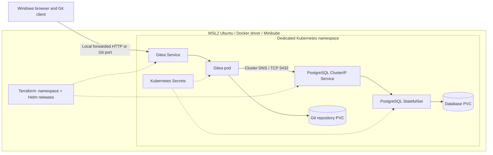

# DEVOPS-001 — Self-Hosted Gitea Platform

**Intermediate · 12–18 hours · Entirely local**

**Assignment version 2.0.0:** adds an explicit final browser-to-Git acceptance gate and failure/retest evidence. The original workload estimate and infrastructure scope remain unchanged.

## Problem statement and business context

Your development team needs a self-hosted Git platform. As its DevOps engineer, provide a reproducible environment on a Windows workstation with WSL2 Ubuntu. The team must create users and repositories, push and clone commits, and retain its work through ordinary pod failures. Another engineer must be able to operate it from your repository.

This is an assignment, not a deployment recipe. You own the infrastructure design and must explain your choices.

## Learning objectives

- Explain Docker, Minikube, Kubernetes, and WSL2 responsibilities.
- Use Terraform to safely manage namespace and Helm release lifecycles.
- Connect Gitea to a separate PostgreSQL workload using cluster DNS and Secrets.
- Distinguish repository files from application metadata and validate both persistence paths.
- Diagnose readiness, storage, connectivity, and configuration issues with evidence.

## Prerequisites

Basic Git, Linux, containers, YAML, and networking knowledge; a Windows workstation with WSL2 Ubuntu and working Docker integration; sufficient resources and the [pinned toolchain](versions.md). Read the [submission standards](../../../standards.md).

## Target architecture

This is a logical topology. Port-forwarding runs on your workstation and must be re-established when its target disappears. Show the actual traffic path and ports in your own diagram.

## Mandatory technology stack

WSL2 Ubuntu, Docker, Minikube with the Docker driver, Kubernetes, kubectl, Helm, Terraform, official Gitea Helm chart, PostgreSQL deployed through Helm, and Git. Use the [version contract](versions.md). No cloud service is part of the runtime.

## Functional and infrastructure requirements

Provide a healthy dedicated namespace, externally configured PostgreSQL, persistent Gitea repository storage, and local web and Git access including from Windows. Terraform must own the namespace and both Helm releases. Configure requests, limits, probes, database identity, Services, DNS, and at least 1 GiB of PostgreSQL PVC capacity. Deliver an idempotent second plan and durable user, repository, commit, and database test data.

The [seven milestones](milestones.md) define the mandatory acceptance criteria. The [verification contract](verification.md) defines required operational procedures and evidence.

## Security requirements

- Commit no real credentials, private keys, cloud credentials, state, plans, or secret-bearing logs.
- Keep PostgreSQL on a ClusterIP Service. Do not publish it on Windows, a NodePort, ingress, or a public interface.
- Use no unnecessary privileged containers. Explain effective security contexts and any required filesystem permissions.
- Document exactly how credentials reach PostgreSQL and Gitea. Prefer pre-existing Secrets referenced by name, with secret material created through a documented bootstrap outside Terraform's state and Helm values. A documented bootstrap is allowed; undocumented manual setup is not.
- Terraform and Helm should receive secret **references**, not passwords. Avoid reading secret data through Terraform data sources. `sensitive` only hides display; it does not remove values from state. Helm release storage and generated configuration can also retain secret material. Explain residual exposure and local state file permissions, disk protection, backup handling, and exclusion from Git.
- Kubernetes Secrets encode data; they do not by themselves provide encryption at rest, rotation, auditing, or least-privilege access. Document who can read Secrets and the workstation's trust boundary.
- Bootstrap must be rerunnable without silently rotating passwords against existing database storage. Never echo credentials or put them in URLs, command arguments, screenshots, or example logs.

## Milestones and deliverables

Complete all seven [milestones](milestones.md). Submit a separate Git repository containing Terraform configuration, Helm values or custom charts, bootstrap and safe cleanup scripts, validation procedures, README, Mermaid architecture, and actual sanitized persistence evidence. Include version locks and a criterion-to-evidence checklist.

Before marking DEVOPS-001 complete, perform the [mandatory final functional verification](verification.md#final-functional-verification-mandatory): open Gitea in the Windows browser, log in as a normal user, create a new repository, clone it locally, commit a file, push it, and confirm the exact commit and file in the web interface. Record commands, exit statuses, results, and sanitized browser evidence. A failed push blocks completion: inspect server logs, resolve the cause, and repeat the test successfully. Ready Pods and a working home page do not satisfy this gate.

## Expected submission structure

Follow the [learner repository tree](../../../standards.md). Include scripts for start, deploy, health, access, logs, persistence tests, stop, and destructive cleanup. The README must let another engineer reproduce all required setup and tests without undocumented cluster changes.

## Constraints and non-goals

Run entirely on the local workstation; downloads from public registries are allowed. Do not require AWS, Azure, GCP, paid services, a prebuilt solution repository, or a custom application. Production availability, multi-node failover, public internet hosting, and guaranteed recovery after cluster deletion are outside the mandatory scope. A local PVC is not a backup.

## Optional stretch goals

Only after mandatory acceptance passes: ingress and local DNS; TLS with a local CA; PostgreSQL backup and restore; NetworkPolicies with an enforcing CNI; resource monitoring; Helm upgrades and rollback; GitHub Actions static validation; automated end-to-end smoke tests. Document extra prerequisites, risks, and evidence separately.

## Review process

Expect a clean deployment, a second Terraform plan, an authenticated Git demonstration, and live persistence checks. Explain why each data path survives each tested event. Reviewer evaluation material is maintained separately from the published site.

## Advanced follow-up

After successfully completing DEVOPS-001, an optional advanced challenge may be assigned by your reviewer.

This challenge builds on your existing deployment and introduces additional reliability and infrastructure engineering requirements. It is separate from the original assignment's workload.

Contact your reviewer after your original submission has been accepted to receive the follow-up instructions.
