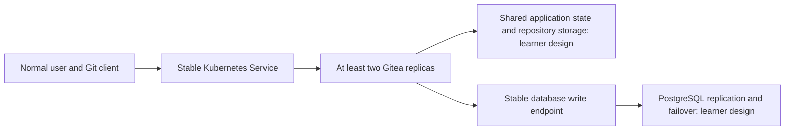

<!-- REVIEWER_ONLY_DO_NOT_PUBLISH -->

# DEVOPS-001-HA — Make Gitea Actually Highly Available

## Project ID and title

**DEVOPS-001-HA: Make Gitea Actually Highly Available** · Follow-up version **1.0.0**, attached to permanent project **DEVOPS-001**. This is a separate post-completion challenge, not a replacement for the baseline assignment.

## Difficulty and expected duration

**Advanced · 16–24 additional hours**, excluding optional work. Domain: Kubernetes; related domains: databases, storage, infrastructure as code, and source control. None of this effort is part of DEVOPS-001's 12–18-hour estimate.

## Problem statement and business context

A team increased Gitea to two Kubernetes replicas and expected uninterrupted Git hosting. Reviewer testing instead recorded one Pod in `CrashLoopBackOff`, a failed Git push, and these diagnostics:

```text
Failed to create queue "notification-service": unable to lock level db at /data/gitea/queues/common
Internal Server Error Decoding Failed
```

These are supplied incident observations, not a fault reproduced by the portal authors. Explain what they do and do not establish. Investigate the local LevelDB queue's ownership and concurrency assumptions, the shared volume, and the effective configuration of both processes. Do not assume the client error proves the server-side cause without matching logs.

Deliver an architecture that supports multiple active Gitea processes and a database primary failure. Prove the user journey through failures rather than treating a replica count as availability evidence.

## Learning objectives

- Distinguish application state coordination from Kubernetes process replication.
- Diagnose queue locking using versioned upstream contracts and correlated runtime evidence.
- Design distributed queue, session, cache, Git storage, and PostgreSQL failover behavior.
- Measure continuity, recovery, data integrity, and remaining failure domains.
- Reproduce the environment with Terraform, Helm, secret references, and a tested runbook.

## Prerequisites

A reviewer has accepted DEVOPS-001, including an attempted and ultimately successful final normal-user browser/clone/commit/push/browser test. Preserve the baseline submission SHA and evidence before branching for this follow-up. If your earlier attempt failed, retain its investigation and resolution; do not leave the baseline broken to begin this challenge.

You need the original toolchain, familiarity with Kubernetes Services and persistent volumes, PostgreSQL replication concepts, and sufficient local capacity for additional workloads. Propose CPU, memory, disk, and timeout budgets to your reviewer before deployment. Use a disposable local test environment and backed-up training data; never inject faults into production or an unrelated cluster.

This handout is released manually by a reviewer. GitHub Pages does not track your completion or authenticate access. Its absence from navigation is not a security boundary; repository readers may discover this source. Do not treat early discovery as baseline completion or reviewer approval.

## Target architecture

Produce your own diagram showing requests, mutable state, process ownership, replication, routing, secret delivery, and physical failure domains. This requirement map deliberately leaves component selection to you:



Map every dependency to a failure domain and identify what happens when it is unavailable. Local Minikube, Docker, WSL, the host, and its disks remain common failure domains even when several Pods or simulated nodes are used.

## Mandatory technology stack

Retain Terraform, Helm, Kubernetes on Minikube, Gitea, PostgreSQL, Kubernetes Secrets, persistent storage, and Git. Use DEVOPS-001's published version contract as the starting baseline: Gitea chart **12.7.0**, application **1.27.0**, and its pinned common toolchain. The baseline single-instance PostgreSQL chart is not evidence of a failover-capable database; select a supported HA deployment method and record its independently pinned chart/operator, application, and image versions.

Select a distributed queue backend supported by your exact Gitea version and explicitly configure shared sessions and caching as required for multiple processes. Prove support from versioned application and backend documentation, including the connection mode you use. Pin every added chart, provider, image tag and digest; commit provider locks. If a baseline component needs replacement, obtain reviewer agreement on a pinned compatibility plan. Do not silently adopt newer configuration keys or enterprise-only capabilities.

Source contracts inspected **2026-10-21**: [Gitea 1.27 configuration documentation](https://docs.gitea.com/1.27/administration/config-cheat-sheet/), [Gitea v1.27.0 example configuration](https://github.com/go-gitea/gitea/blob/v1.27.0/custom/conf/app.example.ini), [official chart 12.7.0 archive](https://dl.gitea.com/charts/gitea-12.7.0.tgz), [PostgreSQL 18 failover responsibilities](https://www.postgresql.org/docs/18/warm-standby-failover.html), and [Kubernetes 1.34 volume access modes](https://v1-34.docs.kubernetes.io/docs/concepts/storage/persistent-volumes/#access-modes). This is documentation and chart inspection only; no HA deployment or failure experiment was executed by the portal author.

## Functional requirements

- Normal-user login, existing-session browsing, creation of repositories, authenticated push, fresh clone, and commit/file browsing work through the stable application endpoint.
- Both Gitea processes observe the same repository state and compatible session/security configuration. A user must not lose authentication merely because the next request reaches the other process.
- Background work uses a supported distributed queue; demonstrate a queued action completing after application replica loss, without recurring queue lock failures.
- Investigate and account for process-local indexers, scheduled maintenance, hooks, and other mutable state enabled by your chart. Disable unused optional features explicitly or justify safe multi-process behavior without deleting required functionality.
- PostgreSQL changes primary through a supported failover mechanism. Application connectivity recovers through the same stable write endpoint without editing Gitea's database host or credentials.

## Infrastructure requirements

Run at least two Ready Gitea replicas behind a Kubernetes Service with appropriate readiness and shutdown behavior. Verify that both are reachable through the normal request path. A diagnostic connection pinned to one Pod is not an HA entrypoint.

Provide safe, concurrently accessible Git repository storage with supported filesystem semantics, permissions, locking behavior, and persistence. Explain the actual storage service, access mode, scheduling constraints, and backing failure domain. Neither two unrelated repository directories nor a claim's access-mode label alone proves shared consistency. Keep queue data placement separate from assumptions about Git storage safety. Inventory non-repository files required by your enabled features as well.

Provide PostgreSQL replication, automatic primary failure detection and promotion through a supported manager/operator, protection against two writable primaries, and recovery of the former primary as a follower. Use an endpoint that follows the writable primary rather than balancing writes across all database Pods. Database instances must not share a writable database data directory. Record expected recovery time and data-loss bounds before testing.

Terraform and Helm must express namespaces, releases, storage declarations, application configuration and HA dependencies, including operator-managed resources where used. Document dependency/CRD ordering and external prerequisites. Secret bootstrap and deliberate fault injection may use documented commands; routine configuration must not depend on unrecorded `kubectl edit`, imperative scaling, or manual endpoint rewrites. Restore the declared desired state and show a final plan without unexplained drift.

## Security requirements

Keep credentials, shared signing/encryption material, private keys, sensitive connection strings, database replication credentials, state, saved plans and secret-bearing logs out of Git. Reference Secrets rather than embedding their data in Terraform or Helm values. Explain residual exposure in state, Helm release records, rendered application configuration, diagnostics, backups and the local workstation.

Keep database and queue/cache access internal to the cluster. Use a least-privilege application database role, appropriate runtime permissions, and controlled local application access. Do not share cookie values or tokens as session-continuity evidence. Fault tests require an explicit context, namespace and target with data-preservation and rollback plans; never delete persistent volumes as a recovery shortcut.

## Milestones and deliverables

1. **Incident analysis:** submit a timeline, sanitized client and server observations, Pod identities, relevant effective non-secret configuration, and a root-cause argument. If you cannot safely reproduce the supplied incident, label it supplied evidence and explain the conditions under which it applies.
2. **Design review:** submit the component/version inventory, state and failure-domain diagram, storage and database migration/rollback plan, backup prerequisite, and agreed recovery/data-loss budgets. Preserve the accepted baseline.
3. **Declarative implementation:** provide Terraform, Helm values or chart sources, locks, secret-reference/bootstrap contract, stable endpoints and a reproducible deployment runbook. Demonstrate concurrent healthy application replicas before fault injection.
4. **Application continuity drill:** terminate one identified Gitea replica deliberately, exercise the full user journey while it is unavailable, record the serving survivor and replacement, then restore the intended topology. Repeat with the other replica as the failed target.
5. **Database failover drill:** interrupt the current primary, observe automatic promotion, verify the stable write endpoint, preserve acknowledged data, resume application writes and demonstrate former-primary recovery as a follower.
6. **Handover:** deliver the criterion-to-evidence matrix, diagnosis report, all failed attempts and successful reruns, measured recovery results, remaining single points of failure, and safe cleanup instructions. Keep it in a separate branch or repository with the baseline and final immutable SHAs.

## Acceptance criteria

| Gate | Pass condition and required evidence |
| --- | --- |
| Diagnosis | Explains why two processes can contend for one local LevelDB queue; correlates or carefully limits the claim linking queue failure and the Git client symptom |
| Shared application state | Effective non-secret backend choices match supported versions on both replicas; queue work completes and authentication survives a change of serving replica |
| Git storage integrity | Both replicas access the same repositories safely; all acknowledged test commits and file checksums survive drills; fresh clones agree |
| Concurrent service | At least two Ready Gitea replicas and matching Ready Service endpoints before drills; requests are shown to reach both |
| Replica loss | Push, fresh clone, existing-session browsing and fresh normal-user login complete through the stable endpoint while the chosen replica is unavailable; repeat for the other replica |
| Database HA | A different database instance becomes primary automatically; unchanged write endpoint routes correctly; acknowledged marker data remains; former primary rejoins as a follower and replication recovers |
| Recovery bounds | Timestamped attempts, errors, retries and recovery meet the pre-agreed budgets; transient failures are counted rather than described as zero downtime |
| Declarative ownership | Clean validation, reproducible deployment, chart/provider/image pins, secret-safe bootstrap, and a final Terraform plan with no unexplained changes |
| Operational safety | Training-only targets, preserved data, internal database/backend Services, least privilege and sanitized evidence |
| Honest HA claim | Separates tested application/database Pod resilience from untested node, host, storage and backend failures; explicitly identifies any remaining single points of failure |

All gates are mandatory. More replicas, a Ready screenshot, a database restart with no primary change, or a client retry without integrity checks is insufficient.

## Verification procedures

Agree on bounded timeouts and retry policy with the reviewer **before** each drill. Record a baseline user, repository URL without credentials, commit SHA, file checksum, database marker in a separate validation table, Pod UIDs, database roles, Service endpoints, and timestamps. Do not modify Gitea-managed database tables.

During each Gitea drill, keep testing through the stable endpoint: make a new uniquely identifiable commit and push it, freshly clone and compare it, browse the file and commit with the existing browser session, and perform a fresh normal-user login in a separate browser session. Demonstrate these operations on the surviving replica before the replacement is Ready, with timestamped request/Pod evidence. If replacement is too fast to prove this, agree on a safe, repeatable degraded-test window; waiting for two replicas to return before testing does not pass. Capture errors and bounded retries, then confirm both replicas recover. Repeat in the opposite direction.

During the database drill, record the current primary identity and replication health, acknowledged Git commits and an independently acknowledged database marker immediately before the fault. Show a different instance becoming primary, the stable endpoint following it, application recovery with no host/credential changes, successful fresh login/push/clone/browsing, unchanged old data, and a new successful write. Record detection, promotion and end-to-end recovery intervals. Demonstrate the former primary rejoining without accepting divergent writes and healthy replication afterwards. No unreported loss of acknowledged test data is acceptable; distinguish observed results from your configuration's theoretical durability guarantees.

For troubleshooting, start with the failed user operation and correlate its timestamp with all relevant Gitea processes, current/previous container logs, backend/database logs, readiness/endpoint changes and volume events. Inspect effective configuration without revealing secret values. Compare storage ownership, authentication, connectivity, backend support and resource pressure as hypotheses. Keep symptoms, investigation, cause, correction and retest separate; avoid disabling locks, deleting data, or bypassing tests to conceal a failure.

## Expected submission structure

```text
README.md                    # DEVOPS-001-HA 1.0.0, baseline/final SHAs, reproduce/cleanup
terraform/                   # declarative resources and committed provider lock
helm/                        # pinned values or custom chart sources
scripts/                     # safe bootstrap, deployment, diagnostics and fault drills
architecture.md              # state map, replication, endpoints and failure domains
versions.md                  # charts/operators/images, digests and upstream contracts
troubleshooting.md           # observations, hypotheses, causes and retests
verification.md              # acceptance matrix, budgets and measured results
evidence/                    # redacted timelines, role/endpoints and Git data checks
```

Submit your repository URL, baseline DEVOPS-001 assignment version and accepted SHA, follow-up version, final SHA, and dated evidence. Include migration/backup/rollback instructions and the runbook for recovery. Do not commit credentials, actual state/plans, private keys, database dumps or raw session data.

## Constraints and non-goals

This is a local failure-recovery exercise, not a production certification. A single-node Minikube cluster cannot demonstrate survival of its node or workstation. Extra Minikube nodes on one Docker/WSL host still share that host and disk. A single shared filesystem or backend can remain a common point of failure: disclose it and limit the HA claim accordingly. Genuine node-level availability requires independent compute/storage/control-plane failure domains and additional testing beyond this baseline.

Do not claim that a distributed queue fixes repository-storage or database failover requirements. Do not substitute independent Gitea installations, a mock API, extra database Pods without replication, or manual database-host changes for the required behavior. No complete Helm values, Terraform implementation, or step-by-step backend configuration is supplied.

## Optional stretch goals

After mandatory gates pass: test backend failover and queue durability, storage-service failure/recovery, backup restore into a separate environment, controlled node-loss on independent hosts, or request-level availability monitoring. Any claim of end-to-end HA must include the dependencies it relies on; untested dependencies stay explicit limitations.

## Reviewer guidance

Expect a live demonstration from your submitted SHA, evidence for both application-replica directions and database primary transition, and questions about shared mutable state and failure boundaries. Your reviewer assesses observed behavior against every gate; solution choices are yours to justify. Baseline completion remains independent of whether you undertake or complete this advanced follow-up.
